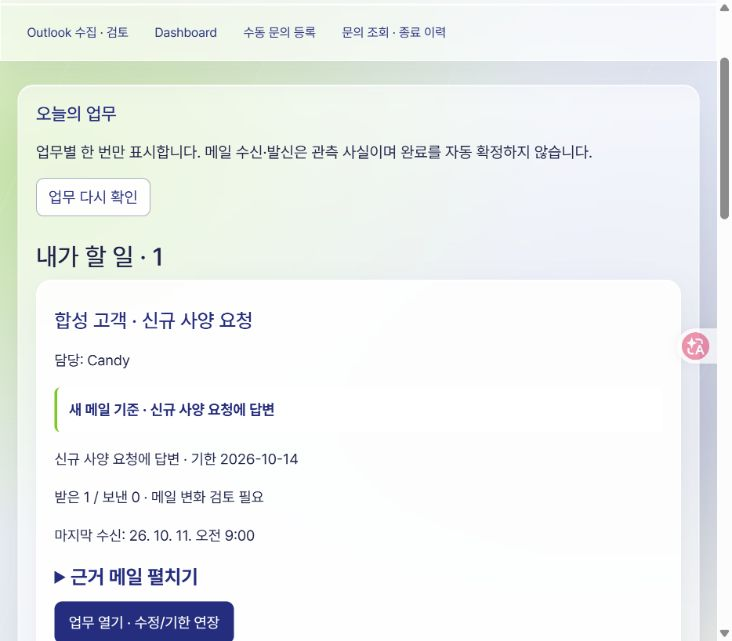
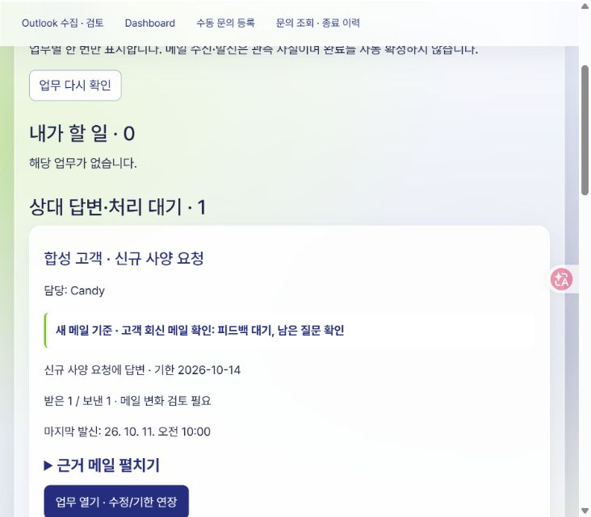

# Source Photonics Sales CRM — 1차 MVP

Codex와 함께 개발한 1인 영업 CRM입니다. Outlook 받은·보낸 메일에서 담당 업무와 다음 행동을 정리하고, 문의·기한·대기·제품 후보·HQ/고객 회신 이력을 관리합니다.

## 개발 결과

- 할 일·답변/처리 대기·판단 필요 중심의 홈 대시보드와 고객/HQ 업무 조회
- 확인된 담당 요청의 문의·기본3일 Action·수신 이력 등록과 재실행 중복 방지
- 받은·보낸 메일 대조, 후속 수신/발신 이력 및 원문 근거 표시
- 평일 한국 시간10:00~18:00 매 정각 확인과 수동 확인 버튼
- 문의/Action 등록·수정·기한3일 연장·완료·사유 있는 취소·종료 이력
- 개인/업무 메모와 기한·완료 관리
- 100G LR4/SR4 두 제품의 사양 필터·출처·후보 검토 이력
- HQ 질문별 답변 검토, 수동 초안/번역/요약·복사·실제 발송 기록 구분
- 로그인·허용목록·소유자 접근통제, 저장 충돌·응답 유실·401 정리
- Source Photonics 로고/색, Frosted 글래스 테마·효과 전환과 로컬 Pretendard

AI는 기획·코딩·디버깅·검증에 활용했습니다. CRM 자체의 AI 요구사양 추출·초안 생성·번역 서비스는 아직 연결하지 않았습니다. 이메일 발송·질문 해결·출하/수령·업무 종료는 별도 근거와 사용자 판단이 필요합니다.

## 계획과 실제 결과

- [최초 보존 계획서 — 2026-10-06 v0.2](docs/development-plan-initial.md)
- [현행 기획서](docs/development-plan.md)
- [개발 보고서 — 제출 설명·최초 계획 비교·구현/검수/미완료](docs/development-report.md)
- [문서 안내와 작업 기록](docs/README.md)

1차 MVP는 현재 기능 범위를 확정한 마감입니다. 실제 신규 요청 자동 저장 사례·장기 정각 수집·1주 실사용 합격은 운영 검수로 남아 있습니다. 기능 완료를 최초 계획 전체 달성으로 확대하지 않습니다.

## 가상 데이터 시연

실제 CRM UI 모듈을 가짜 API/메모리 데이터로 검수한 화면입니다. 실제 고객·메일·DB·자격증명이 없으며 운영 저장 성공 화면을 의미하지 않습니다.

### 신규 요청 → 내가 할 일



### 고객 회신 → 답변 대기



## 설치·기능 검수

Node.js와 Python이 필요합니다.

```powershell
npm ci
npm test
npm run build
python -X utf8 -m unittest discover -s tests -p 'test_outlook*.py'
```

2026-10-13 검수 기록: Node163/163·Outlook Python94/94·브라우저 빌드 성공. 자동 검사를 실제 운영 성공/업무 개선율로 해석하지 않습니다.

로그인이나 실제 DB 없이 UI를 확인하려면:

```powershell
node tools/mail-review-verification.mjs
```

Chrome에서 `http://127.0.0.1:4330/`을 엽니다. 가상 신규 요청 도착·수동 확인·고객 발신 시험을 사용할 수 있습니다. 포트가 다른 프로그램/OS 예약에 묶인 환경에서는 별도의 사용 가능한 loopback 포트 구성이 필요합니다. 검수 데이터는 다시 열면 초기화됩니다.

## 실제 PC 운영

현재 실제 MVP는 로컬 Chrome의 `http://127.0.0.1:4327/`에서 사용합니다. `start-crm.cmd`는 프로젝트 서버를 확인·실행합니다. 기존 개인 `.env`, 승인된 Supabase 계정/스키마와 D드라이브 보호된 메일 검토 자료가 필요합니다. 공개 저장소만 복제하면 이 개인 운영 자료는 제공되지 않습니다.

자동 확인에는 로컬 서버·CRM 연결·탭 유지와 Classic Outlook 실행이 필요합니다. PC/탭이 닫힌 상태의 상시 수집 및 외부 웹 배포는 포함하지 않습니다. `src/worker.mjs`는 Workers용 API 기반이며 실제 Cloudflare 배포는 미완료입니다.

기존 적용 SQL은 반복 적용용 migration 도구가 아닙니다. 자기 환경에서 사용할 때에는 스키마/권한과 각 작업 기록을 먼저 확인해야 합니다. 운영 DB에 검수용 SQL을 임의 실행하지 않습니다.

## 저장소 범위

프로젝트 소스·SQL·테스트·계획서·보고서·작업 기록과 Git 이력을 포함합니다. `.gitignore` 대상인 실제 `.env`, 개인 notes, 메일/DB 원본·캐시·백업, 인증정보와 node_modules/dist는 포함하지 않습니다. `.env.example`은 값이 없는 공개 설정 예시입니다.

Pretendard는 공식 v1.3.9 글꼴을 포함하며 [SIL Open Font License 전문](web/assets/fonts/Pretendard-LICENSE.txt)을 함께 제공합니다.
