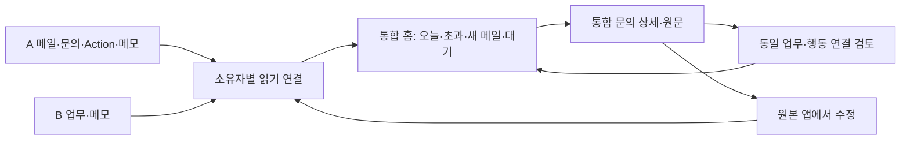

# 두 CRM 기능·데이터 대조표와 통합 계획

- 프로젝트: sp-sales-crm / 개발 기획 / revision 1 / 2026-10-20
- 상태: 문서 검토용 제안 완성. 통합 구현·데이터 이전·배포는 미승인이다.
- 사용자 확정: 두 CRM의 중복을 줄이고 **메일·문의·오늘 할 일을 한곳에서 조회**하는 것을 1차 목표로 한다. 실제 앱 변경은 문서를 본 뒤 결정한다.
- 작성자 권고: **A를 통합 홈의 기반으로 유지하고 B를 읽기 연결한다. 1차에는 원본 DB를 합치지 않는다.** 같은 업무는 한 카드로 묶고 원본·고유 기능은 보존한다.

## 1. 비교 대상과 근거의 범위

| 구분 | A: 여기서 만든 sp-sales-crm | B: Source Photonics CRM |
|---|---|---|
| 저장소 | Candy-Park/sp-sales-crm | Candy-Park/source-photonics-crm |
| 조회한 로컬 HEAD | cd1d8569067bdc5d75d80d9d997065a6b6ad179a | 9b368dd33f44d35d6945c2225f2b99dad59fcc2a |
| 주된 구조 | JS 웹·API, Supabase sales_* 관계형 데이터, Windows Outlook 수집기 | React/TypeScript, Python/SQLite 로컬 업무, Supabase crm_* 클라우드 저장소 코드 |
| 실제 상태 판단 | 수집·문의·Action·외부 접속 구현과 과거 기능 검수 기록 존재 | 초기 시안을 넘어 업무·메모·영수증 구현 존재. 최신 편의 기능은 로컬 검증 및 배포 후보까지, 원격 적용은 보류 기록 |
| 주의 | PC가 꺼져도 저장 업무는 사용 가능하다는 기존 기록. 새 메일은 PC·Outlook·인증 연결 필요 | 로컬·스테이징·운영이 같은 데이터라고 간주하면 안 됨. 실제 운영 대상·최신 DB 적용 여부 확인 필요 |

이는 **소스·스키마·기존 검증 기록의 대조**다. 이번에 실데이터를 조회하거나 앱 E2E를 실행하지 않았다. 중복 건수·실제 데이터량·현재 원격 상태는 미확인이다. source-photonics-intranet과 업무 포털은 별도 프로젝트로, 이번 비교 대상이 아니다.

B의 AGENTS.md와 PROJECT-BASELINE.md/README 일부는 초기 단계 설명을 유지하지만 현재 코드와 최신 operations 기록에는 저장·인증 기능이 있다. 이 차이는 지침의 보존·보안 규칙을 무시할 이유가 아니며, 구현 사실 판단에 최신 코드와 해당 작업 기록을 함께 쓴다. B 지침은 수정하지 않는다.

## 2. 기능 대조표 — 무엇을 하나로 하고 무엇을 남기는가

‘중복’은 목적이 겹친다는 뜻이다. 실제 데이터가 같다는 뜻은 아니며 아래 처분은 모두 승인 전 제안이다.

| ID / 기능 | A 확인 내용 | B 확인 내용 | 통합 처분 / 시점 |
|---|---|---|---|
| C01 홈·오늘 할 일 | Inquiry·Action·메일 변화, 내가 할 일/대기/판단/완료 분류 | 오늘·기한 초과 업무와 메모, 접힌 전체/완료 목록 | **홈 하나로 통합**. B의 날짜 중심 요약을 참조하고 A의 메일 변화·대기 정보를 유지 / 1차 |
| C02 문의·수동 업무 | 고객·담당자·프로젝트 연결, Inquiry 아래 복수 Action | customer/hq 업무, 제목·요약·다음 행동·기한·장기 진행 | 목록·검색을 통합. 저장과 수정은 원본에서 유지 / 1차 |
| C03 메일 수집·선별 | Outlook 받은/보낸 메일, 수집·검토·후속 대화·일부 신규 요청 자동 등록 | 원문 HTTP(S) 링크 저장. 실제 메일 자동 수집·발송은 미구현 | **A 수집기만 채택**, B용 수집기를 새로 만들지 않음 / 1차 |
| C04 메일→업무 연결 | 사용자 검토 및 자동 등록 대상 제한, 기존 대화 연결 | sourceLinks로 자료/메일 URL 참조 | 원문·연결 문의를 한 상세에서 조회. URL만으로 동일 메일/업무 확정 금지 / 1차 |
| C05 기한·대기·완료 | Action별 기한/대기 대상, 기본 3일·연장, 필수 Action 종료 검사 | 업무별 단일 기한·nextAction, 전달 확인 및 완료 이력 | 표시 규칙만 통합. 기한·완료·이력의 원본 저장 규칙 유지 / 1차 |
| C06 메모·빠른 기록 | 로컬 SQLite 메모, 외부용 sales_remote_memo 및 이력 | 개인/업무 메모, 기한·완료·수정 버전, 메모→후속 업무 연결 | 메모 목록과 기한 항목 통합 조회. 메모를 Inquiry로 강제 전환하지 않음 / 1차 |
| C07 검색 | 기존 업무·메일 조회 경로 | 고객명·제품명·본문·초안·메모 단어 검색 | 홈 검색 입구 하나, 출처별 검색 결과/조회 범위 표시 / 1차 |
| C08 제품 검색 | sales_product 및 Inquiry 후보 연결·사양/출처 | 단일 PDF의 메모리 검색 파일럿; 전체 색인은 미구현 | 두 방식 보존, 기존 상세에서 접근. 검색엔진·제품 DB 병합은 제외 / 후속 |
| C09 HQ 질문·고객 회신 | 질문별 검토, 메시지·초안·실제 송수신 구분 | 한·영 초안 필드, 고객 문의/독립 본사 요청 구분 | 기존 기록 조회·원본 이동 유지. 질문/초안 모델 병합·AI 추가는 후속 |
| C10 완료·재개 이력 | Inquiry 종료 조건·Action·메시지 이력 | completion_history, 전달 확인, 수정 버전 | 이력 삭제 없이 출처별 표시. 서로 다른 완료 의미를 강제 변환하지 않음 / 1차 |
| C11 로그인·소유권 | sales_access + owner_id 및 RLS | crm_allowed_users + owner_id 및 RLS, 로컬 연결 키 | 각 원본 권한 유지. 한 화면이라고 로그인까지 하나로 복제하지 않음 / 1차 |
| C12 사진 영수증·OCR·XLSX | 해당 경비 모듈 없음. sales_remote_receipt는 **API 재시도 영수증** | crm_receipt·Drive 사진·OCR·엑셀 코드, 최신 원격 적용은 미확인 | **동명이지만 다른 데이터**. B 고유 기능으로 보존, 통합 홈 업무에 섞지 않음 / 범위 밖 |
| C13 테마·메뉴 | B/Frosted·Pretendard 및 SP 브랜드 적용 | React 앱 셸·카드·SP 스타일 | 이미 도입한 스타일을 재개발하지 않음. 홈 진입점만 통합 / 1차 |

사용자 입장에서 없애는 중복은 ‘같은 문의를 두 번 찾는 일, 같은 업무의 카드 두 개, 같은 원문을 재등록하는 일’이다. 기존 앱·테이블·실행 경로·영수증·제품자료를 삭제하는 계획이 아니다.

## 3. 데이터 대조표와 기준 원본

1차 기준 원본은 **현재 기록을 가진 시스템**이다. A를 기반으로 쓴다는 이유로 B의 모든 값이 A보다 낮은 우선순위가 되지는 않는다. 아래 공통 필드는 새 통합 조회 모델 제안이며 현재 존재하는 API/테이블로 주장하지 않는다.

| 데이터 | A의 구조/필드 | B의 구조/필드 | 공통 조회·연결 및 손실 방지 |
|---|---|---|---|
| 사용자 | sales_access.user_id, 각 owner_id | crm_allowed_users.user_id, crm_work/crm_memo.owner_id; 로컬은 별도 연결 | source+environment+owner 단위로 구분. 같은 이메일이라도 UUID/권한 자동 동일시 금지 |
| 고객·연락처·프로젝트 | sales_customer/contact/project의 관계·ID | WorkInput.customerName 선택 문자열; 별도 동일 관계 확인 안 됨 | customerRef와 customerLabel 분리. 고객명만 같다고 고객/문의 병합 금지 |
| 문의/본사 업무 | sales_inquiry의 id/title/channel/received_at/original_text/status/next_action/revision | 로컬 work.payload_json, 클라우드 crm_work.input 및 initial_input; kind=customer/hq | 공통 Case에 sourceRefs, kind, title, summary, statusRaw. B hq는 독립 본사 업무로 유지하며 허위 고객을 생성하지 않음 |
| 요약·원문 | original_text 원문, 메시지의 summary/body | summary, memo, draftKo/draftEn 및 initial_input | summary를 original_text로 바꾸지 않음. 원문·요약·개인 메모·초안 별도 역할 유지 |
| 실행 업무 | sales_action: inquiry_id/kind/description/due_date/status/mandatory/waiting_target/revision | Work의 nextAction/dueAt; 독립 복수 Action 테이블 없음 | A는 기존 Action ID별 항목, B는 원본 Work에 연결한 조회용 Action. 새로운 완료 데이터로 저장하지 않음 |
| 날짜 | received_at는 시각, due_date는 날짜; waiting_since/closed_at | receivedAt/dueAt는 날짜, createdAt/updatedAt는 시각 | 수신 시각과 접수일을 구별. B 날짜에 임의 수신 시각을 붙이지 않음. 업무 날짜는 서울 기준 |
| 메일 | sales_outlook_mail: scope_key/source_key/fingerprint/original/direction/state/inquiry_id | sourceLinks(label,url), 원문 메일 테이블 확인 안 됨 | Mail 참조와 일반 URL 구분. A source_key는 scope·owner와 함께 사용; B URL을 A source_key로 변환하지 않음 |
| 회신·질문·초안 | sales_message, sales_hq_question/review, 실제 발송 및 질문별 답변 상태 | draftKo/draftEn, summary, completion.summary | 초안을 발송 이력으로 바꾸지 않음. 부분 답변을 완료로 합치지 않음 |
| 메모 | SQLite memos/memo_history/memo_requests; 외부 sales_remote_memo/history | crm_memo 및 Memo(content/category/dueDate/completedAt/revision) | 본문·분류·기한·완료·버전 보존. 로컬/클라우드가 별개면 각각 원본 출처 기록 |
| 메모→업무 | 동일 연결 모델 확인 안 됨 | WorkInput.sourceMemoId, 고정 생성 요청 키 | sourceMemoId 관계 보존. 메모와 후속 업무는 연관 레코드이지 삭제할 중복이 아님 |
| 제품 | sales_product/sales_inquiry_product | productName 문자열, local_search/sample.py 파일럿 | 표시용 제품명과 실제 제품 ID 분리. 원문 파일·해시·출처 보존; 1차 변환 안 함 |
| 완료·감사 | Action completed/cancelled·사유·문의 closed_at 및 revision | completion(deliveredAt/summary/confirmed), completion_history, revision | 원본 상태/완료 이력을 출처별 유지. 서로 다른 revision 비교 또는 큰 번호 우선 금지 |
| 재시도·스냅샷 | requestId, sales_remote_receipt, sales_remote_snapshot/command | request_id/initial_input, RPC expected_revision, 로컬 requests | 재시도 키를 업무 ID로 쓰지 않음. snapshot은 관측 캐시이며 문의·Action 정본을 덮어쓰지 않음 |
| 사진 영수증 | sales_remote_receipt는 요청·응답 보존 | crm_receipt와 Drive 원본 파일 참조 | 두 receipt를 매핑하지 않음. Drive 원본은 DB 백업만으로 복구되지 않음 |

### 상태를 하나로 보이게 하는 규칙

원본 상태는 항상 표시하고, 공통 ‘내 행동/대기/판단 필요/완료’는 조회용 분류로만 계산한다.

| 원본 | 공통 표시의 기본값 | 보존할 예외 |
|---|---|---|
| A new/product_search/need_hq_confirmation/customer_reply_needed | 내 행동 또는 판단 필요 | 실제 open Action·사용자 확정·새 메일 관측을 같이 확인 |
| A waiting_for_hq/waiting_for_customer | 대기 | open Follow-up의 기한이 오면 오늘 할 일에도 포함 |
| A closed | 완료 | 종료 후 새 메일은 ‘추가 검토’로 별도 표시. 자동 재개하지 않음 |
| B customer 새 문의/제품 확인 중/고객 답변 준비 | 내 행동 | 고객 답변 준비는 실제 발송 완료가 아님 |
| B customer 본사 답변 대기 | 대기 | 부분 답변은 계속 대기, 기한 도래는 할 일 표시 |
| B hq 새 요청/처리 중/답변 준비 | 내 행동 | 독립 HQ 업무를 고객 Inquiry의 상태로 손실 변환하지 않음 |
| B hq 상대 답변 대기 | 대기 | 중간 회신은 완료가 아님 |
| B customer 종료 / hq 완료 | 완료 | completion과 이력을 함께 보존. 다른 원본이 미완료면 충돌 표시 |

## 4. 중복을 제외하는 정확한 기준

1. **원본 식별**: `(source, environment, owner, entityType, id)`로 레코드를 식별한다. A/B와 local/staging/production 사이에서 UUID가 같아도 같은 건으로 보지 않는다.
2. **안전한 자동 묶음**: 이미 사용자가 확정한 동일 업무 연결, 같은 원본 키의 재조회/재수집만 자동 적용한다. 원본 메일·업무 ID가 없으면 제목·이메일·본문 유사도만으로 확정하지 않는다.
3. **후보 제안**: 제목·고객·P/N·접수일·메일 URL이 겹치면 후보로 제시한다. 서로 다른 수량·주문·프로젝트·반복 요청은 별도 업무일 수 있다. 사용자가 ‘동일 업무/별도 업무/나중 확인’을 고른다.
4. **묶는 수준 분리**: 같은 Case 연결과 같은 Action 연결을 따로 확정한다. 같은 문의의 ‘HQ 확인’과 ‘고객 회신’은 모두 남긴다. A·B의 같은 후속 행동이라고 확인한 경우에만 할 일 한 행으로 묶는다.
5. **우선 표시**: 명시한 대표 원본의 값을 우선 표시하되 기한·상태·완료 충돌은 배지와 양쪽 값으로 노출한다. 값이 다르면 updated_at만으로 이기게 하지 않는다. 연결된 행동 중 한 원본이라도 미완료이면 미완료로 조회하며, **미완료 원본 중 가장 이른 유효 기한**으로 오늘/초과 포함 여부와 정렬을 계산한다. 대표 기한도 별도로 표시해 충돌을 감추지 않는다. 모든 원본에서 완료/취소가 확인되어야 오늘 목록에서 제외한다.
6. **메모 관계**: 원본 메모와 파생 업무가 연결되면 상세에는 둘 다 남긴다. ‘오늘 할 일’에서 동일 행동임을 확정한 경우만 업무 행에 메모 링크를 붙이고 메모 행을 접는다. 연결만으로 자동 완료/삭제하지 않는다.
7. **안전한 해제**: 연결 해제는 공통 묶음만 되돌린다. 원본 기록·완료·메일 연결을 삭제하지 않는다. 누가 언제 어떤 근거로 묶고 해제했는지 기록한다.

통합 연결대장(가칭 IntegrationLink)은 새로운 설계다. owner, sourceRefs, 연결 수준(case/action), 대표 원본, 확인자·시각·근거, 버전, 해제 이력을 갖는다. 저장 장소·RLS·스키마는 구현 승인 시 확정한다. 원본 내용을 복사하지 않는 **참조 메타데이터**로 최소화하되 계정 간 연결 자체도 권한 승인을 받아야 한다.

카운트는 ‘통합 업무 N건’과 ‘미완료 행동 M개’를 구분한다. 메일 여러 통은 별도 메일 수이며 업무 수에 더하지 않는다. 미확정 중복 후보는 숨기지 않고 별도 표시하므로 초기 숫자는 잠정치다.

## 5. 1차 MVP 요구사항과 화면

기존 A 홈을 입구로 유지한다. 새 React 전면 전환, DB 교체, 두 인증을 합치는 작업은 요구하지 않는다. 아래는 신규 구현 제안이다.

| ID / 우선순위 | 입력·동작 → 결과 | 필수 의존성 / 관찰 가능한 합격 기준 |
|---|---|---|
| F01 / now 필수 | 원본별 허용 계정으로 조회 → 출처·환경·갱신 시각을 가진 읽기 결과 | 대상 환경·사용자 매핑 확정. A만/ B만/양쪽 실패를 구별, 다른 소유자 0건 노출 |
| F02 / now 필수 | Case/Action/메모 관계를 변환·연결 확인 → 중복 없는 조회 모델 | F01. 같은 Case 1카드, 서로 다른 Action은 보존, 재조회로 연결 중복 없음 |
| F03 / now 필수 | 서울 오늘 날짜·미완료·기한 → 오늘/초과/대기/판단·기한 없음 표시 | F02. 완료는 오늘에서 제외, 기한 없는 것도 전체 목록에서 찾음 |
| F04 / now 필수 | A 기존 수집 자료 → 새 메일·연결된 문의·원문 근거 | F01,F02. 수신/발신 구별, 보류 원문 보호, PC 중단 시 마지막 확인 표시 |
| F05 / now 필수 | 문의 카드·검색 → 문의 요약/복수 행동/원문/원본 이동 | F02,F04. 양쪽 출처 추적, 기존 수정 화면 이동 후 갱신 가능, 전 페이지 조회/범위 표시 |
| F06 / now 필수 | 기한 메모·빠른 기록 이동 → 통합 홈과 원본 메모/등록 화면 연결 | F02,F03. 본문·기한·sourceMemoId 보존, 기존 등록/완료 절차 유지 |
| F07 / next | 확정된 변환 규칙+백업 → 선택 업무/메모를 A 저장소로 이전 | F01~F06 합격 및 별도 이전 승인. 초기 목표의 선행 조건이 아님 |
| F08 / later | 제품 검색·HQ 작성·영수증 진입점 개선 | 업무 조회 안정화 후 별도 범위 결정 |
| F09 / out | 자동 발송·AI 자동 완료·모든 데이터 일괄 삭제·기존 앱 폐기 | 이번 범위에서 실행하지 않음 |

| 진입점 | 표시·행동 | 빈 상태 / 오류 / 다음 이동 |
|---|---|---|
| P01 통합 홈 (F01~F06) | 상단 마지막 확인·원본 연결 상태, 오늘·초과 할 일, 새 메일/판단, 대기, 접힌 전체/완료; 검색·빠른 기록 | 진짜 0건/소스 미연결/미조회 구별. 부분 실패는 정상 소스 유지. P02/P03 또는 기존 등록 화면 |
| P02 통합 문의 상세 (F02,F04,F05) | 한 줄 요약, 출처·원본 상태, 복수 Action과 기한, 메일 타임라인, 연결 메모, 양쪽 원본 열기 | 미연결 메일·원문 보류·권한 만료 이유 표시. P01 복귀·P03·해당 원본 수정 화면 |
| P03 중복 연결 검토 (F02) | 나란히 비교, 동일 Case/동일 Action/별도/보류 선택, 연결 해제 | 근거 부족은 보류. 저장 충돌 시 선택 유지·최신 재조회. P02/P01 복귀 |
| P04 원본 메모/등록/수정 (F05,F06) | 기존 A/B 화면에서 실제 수정; 통합 화면은 완료·기한을 직접 이중 저장하지 않음 | 인증이 필요한 원본이면 해당 로그인으로 이동. 돌아와 재조회할 때 최신값 표시 |

기본 흐름: 홈에서 오늘/초과 행동을 확인 → 문의 요약과 새 메일 근거 확인 → 필요 시 중복 연결 확인 → 해당 원본 앱에서 처리 → 통합 홈 재조회. 메일 수집이 일부 신규 요청을 자동 등록하는 기존 A 규칙은 보존하되, B 자료를 읽었다는 이유로 신규 문의를 자동 만들지 않는다.

조회 정렬: 미완료 기한 초과(오래된 기한부터) → 오늘 기한 → 새 요청/판단 필요 → 향후/기한 없음·대기. 대기 중 Follow-up이 오늘이면 할 일에도 나타나되 총 고유 행동 수에는 한 번만 포함한다. 종료 후 새 메일은 완료 업무를 자동 재개하지 않고 ‘추가 검토’에 올린다.

## 6. 연결 구조·계정·저장 제약

- A/B의 기존 인증·허용 계정 검사를 각각 통과해야 한다. 한 Supabase 토큰을 다른 프로젝트에 재사용하거나 service-role 키를 브라우저에 두지 않는다. ‘화면 하나’가 첫 연결 시 로그인 한 번을 보장하지 않는다.
- B 클라우드 읽기는 기존 list_work 및 메모 조회 경로를 재사용하는 어댑터 후보다. 크로스 앱 읽기·CORS·세션 처리는 **현재 통합 API가 있는 것이 아니라 구현할 부분**이다. 대상 환경과 허용 origin을 먼저 정하고 기존 인증 게이트를 유지한다.
- B가 로컬에만 있는 항목은 별도 로컬 읽기 연결이 필요하다. PC가 꺼지면 해당 소스는 미연결로 표시한다. 외부에서도 반드시 보여야 한다면 승인된 원격 원본 또는 최소 스냅샷 저장을 추가로 결정해야 하며, 이를 정하기 전 ‘전체 데이터 상시 조회’ 합격을 선언하지 않는다.
- 초기 권고는 B의 실사용 원본 하나를 확정해 연결하는 것이다. local/staging/production을 모두 업무 원본으로 합치지 않는다. 여러 원본에 고유 실업무가 있으면 목록화 후 추가한다. 접근이 안 되는 소스를 조용히 범위 밖으로 빼지 않는다.
- 조회 캐시는 메모리 세션 범위가 기본 제안이다. 페이지를 닫아도 남는 B 본문 캐시·A 클라우드 복사·일괄 전송은 별도 승인 범위다. 네트워크 장애는 이미 읽은 자료를 해당 세션에서 ‘이전 조회’로 표시한다. 세션 만료는 해당 소스 자료를 재인증 전까지 잠그고, 명시적 권한 거부·소유권 변경·로그아웃·계정 변경은 해당 캐시를 폐기한다. 이미 열린 통합 상세·검색 결과·묶음 카드에서도 해당 소스 본문을 즉시 숨기며 다른 허용 원본의 자료만 유지한다.
- 새로운 통합 조회에는 부분 실패·페이지네이션이 필요하다. A 현재 홈의 최근 100건 및 snapshot 제한을 전체 건수로 오해하지 않는다. 원본별 끝까지 조회하거나 ‘일부 조회/더 보기’를 명시한다. B list_work의 커서 반복 방지 규칙을 유지한다.
- 메일 원문·긴 본문·인증정보 의심 자료의 표시 보류와 소유자 통제를 유지한다. 전체 사서함 AI 전송·첨부 전체 분석·외부 발송은 추가하지 않는다.
- 코드는 기존 프로젝트에 유지한다. 납품·백업·변환 결과는 D의 프로젝트별 outputs/sources/scratch에 저장하고 개인 원본·식별자·인증정보는 공개 Git 문서에 넣지 않는다.
- 기존 기획서의 ‘기존 sp-crm 별도 보존·MVP 통합 제외’와 이번 통합 목표는 범위가 다르다. **문서 기획 요청만 확정**되었으며 기존 구현·보존 제약을 덮어쓰지 않는다. 실행 승인 시 이번 1차 읽기 연결에 한해 범위 변경을 기록한다.

## 7. 실행 계획과 단계별 중단 조건

날짜·비용·소요 기간은 합의하거나 측정하지 않았다. 기존 자원 재사용을 우선하되 새 서비스·유료 호출을 전제하지 않는다. 아래는 문서 승인 후 수행할 계획이다.

| 단계 | 할 일·결과물 | 통과 조건 / 실패 시 |
|---|---|---|
| 0 대상·권한 확정 | B 실제 업무 원본 환경·계정·메일 소스, 원본별 데이터량/기간/고유 업무/미이관 필드 목록 | 양쪽 조회 권한과 적용 스키마 확인. 접근 불가하면 표시하고 보류; 시험 데이터로 대체해 전체 완료 주장 금지 |
| 1 격리 비교·설계 검증 | 합성 데이터로 읽기 어댑터·공통 조회 모델·연결대장·페이지 처리 검증 | F01/F02, 원본 불변·다른 소유자 차단. 계정 연결·데이터 복사 허용 범위가 없으면 실업무 연결 중단 |
| 2 홈·메일·상세 통합 | F03~F06, 기존 홈 경로에서 원문까지 추적, 기존 수정 화면 연계 | 아래 T01~T12의 1차 기능 검수. 전면 UI/DB 개편으로 범위 확대하지 않음 |
| 3 사용자 운영 검수 | 승인된 실제 데이터로 사용자와 주요 업무 누락/중복 비교, PC 꺼짐·복귀 확인 | 기능 합격과 실사용 합격 별도. 남은 장애/미조회 소스 기록; 기존 앱 계속 사용 가능 |
| 4 선택적 저장 통합 | 2차 별도 계획: B Work/메모→A 확장 모델 및 원본 참조·완료 이력 매핑 | 별도 승인·사전 백업·격리 복원·차이표·재실행 검증 후에만 쓰기. 1차 필수 아님 |

2차에서 B Work를 A Inquiry 하나와 Action 하나로 일괄 변환하지 않는다. 독립 hq 유형, 고객 미지정 허용, longRunning, sourceLinks/sourceMemoId, draftKo/draftEn, initial_input, completion_history를 담을 목표 구조를 먼저 확정한다. 현재 A 필수 customer_id·original_text에 임의 고객/가짜 원문을 채우지 않는다. B 날짜의 정밀도, 완료 확인과 기존 ID/요청 키도 별도 보존한다.

이전 시 원본별 추출 manifest(환경·소유자·스키마·건수·파일 크기·해시)를 D에 보관하고 격리 후보에서 복원한다. `기존 수 = 대표 통합 수 + 중복 별칭 수 + 보류/제외 수`를 원본 매핑 기준으로 설명하고, 모든 원본 ID가 최소 한 상태에 남는지 검사한다. 같은 원본 키 재실행은 추가 생성 0건이어야 한다. 업무만 백업하는 기존 도구를 메모·영수증·Drive 사진 전체 백업으로 오인하지 않는다.

복원 원칙: 1차 장애는 통합 메뉴/읽기 연결만 비활성화하고 기존 앱과 로그인·데이터를 계속 사용한다. 연결대장은 내보내기 후 복구하며 원본에는 쓰지 않는다. 2차는 실패 지점의 이전 작업만 멈추고 원본에서 재개한다. 화면 되돌리기를 데이터 복원으로 간주하지 않으며 운영 DB 자동 삭제/rollback은 하지 않는다.

## 8. 1차 합격 시나리오 — 아직 실행하지 않은 검수 기준

검수자는 구현 담당자(합성·권한·실패)와 사용자(승인한 실업무·사용 흐름)다. 아래 데이터는 모두 가상 예시다.

| ID | 입력/조건 | 기대 결과 |
|---|---|---|
| T01 | 같은 Inquiry/Work, 메일 3통, 확정한 Case 연결 | 카드 1개·메일 3통. 재조회 후 개수 불변 |
| T02 | 같은 제목·고객이지만 주문 또는 P/N이 다른 두 요청 | 후보 표시 가능, 자동 병합/숨김 없음 |
| T03 | 같은 Case에 HQ 확인·고객 회신 Action 2개 | 카드 1개·할 일 2개. 메일 수와 할 일 합계 분리 |
| T04 | A/B에서 동일 행동 1개로 확정, 대표 원본은 완료 또는 내일 기한, 다른 원본은 미완료·어제 기한 | 고유 행동 1개와 충돌 경고, 초과 목록에 반드시 표시. 대표값과 미완료 원본의 가장 이른 기한을 함께 표시 |
| T05 | 서울 날짜 경계 직전/직후, 어제·오늘·내일·기한 없음·완료 자료 | 오늘과 초과 정확히 구분, 완료 제외, 기한 없음은 전체에서 조회 |
| T06 | 대기 중인 업무에 오늘 Follow-up | 대기와 오늘에서 찾되 총 고유 행동은 1개 |
| T07 | 메모→후속 업무 연결, 같은 행동 확인 / 서로 다른 행동 | 전자는 업무 행+원본 메모 링크, 후자는 둘 다 표시. 원본 메모·이력 보존 |
| T08 | PC·Outlook 종료, B 로컬 미연결, 원격 저장 업무는 조회 가능 | 출처별 마지막 확인/미연결 표시. 조회 실패를 0건·완료로 표시하지 않음 |
| T09 | A 정상/B 네트워크 실패·세션 만료·권한 거부 및 복귀 | A 계속 표시. B 네트워크 실패는 이전 조회 표시, 만료는 잠금, 권한 거부는 본문·캐시 폐기. 열린 상세·검색에서도 적용. 복귀 조회 후 중복·오래된 값 덮어쓰기 없음 |
| T10 | 서로 다른 owner/environment의 같은 ID, 로그아웃 후 다른 계정·소유권 변경 | 자동 연결 없음, 다른 소유자 데이터 0건. 세션 캐시와 열린 상세·검색의 이전 계정 자료 제거 |
| T11 | 101건 이상·페이지 실패·반복 커서·원문 held·종료 후 새 메일 | 누락 범위/오류 명시, 원문 보호, 종료 자동 해제 없이 추가 검토 |
| T12 | 상세→원본 수정→홈 복귀·재조회, 연결 저장 재시도·해제 | 수정값 재조회, 동일 연결 중복 0개, 해제 후 원본 둘 다 보존 |

통합 조회 이전/이후의 원본 건수·원문·상태·기한·완료 이력에 변경이 없어야 한다(사용자가 원본 앱에서 직접 수정한 건은 별도). 실제 새 세션·모바일·PC 복귀까지 검증한 범위만 완료로 기록한다. 장기 실사용과 성과 개선율은 별도로 확인한다.

## 9. 문서 검토 시 결정할 사항

| 결정 | 권고 | 미결의 영향·확인 방법 |
|---|---|---|
| D01 통합 기반·1차 범위 | A 기반 + B 읽기 연결, 원본 보존 | 사용자 승인 전 앱 변경 없음. 반대 선택이면 화면 구현 대상 재설계 |
| D02 B 실사용 원본 | 실제 쓰는 local/클라우드 환경을 먼저 한 곳 확정 | 개발 담당자가 적용 스키마·계정·자료 목록 조회 후 사용자 확인. 미조회 고유 업무는 누락 위험 |
| D03 PC 꺼진 상태의 범위 | 기존 원격 저장 업무는 조회, 로컬 전용 자료는 미연결을 명시 | 로컬 고유 자료도 상시 조회하려면 최소 스냅샷/이전과 전송 허용 범위를 추가 승인 |
| D04 연결대장·출처 간 접근 | 소유자별 참조 메타데이터, 두 권한 검사 유지 | 저장 위치·허용 origin·인증 전환을 개발자가 상세 설계해 실행 전 확인. 현재 가능한 통합 API로 가정하지 않음 |
| D05 2차 저장 통합 | 1차 실사용 후 선택 | DB 이전·기존 앱 폐기·영수증 이전은 이번 승인에 포함하지 않음 |

다음 실행의 첫 작업은 D01~D04와 대상 원본을 확정하고 단계 0을 수행하는 것이다. 기획 상태는 **검토용 제안**으로 유지한다. 이 문서는 구현·계정 변경·원격 쓰기·데이터 이전·발송·배포를 자동 승인하는 지시가 아니다.

## 10. 확인한 근거 파일

표기 A는 이 저장소, B는 비교 저장소의 루트 기준이다. 개인 데이터 경로·실제 문의/계정 정보는 싣지 않는다.

- A: `docs/development-plan.md`, `docs/development-report.md`(외부 접속 절), `docs/decisions/review-and-decisions.md`(2026-10-10 장점 도입 제안 및 이후 확정 이력), `docs/remote-access-design.md`.
- A: `db/schema-basic.sql`, `db/communication.sql`, `db/outlook-collection.sql`, `db/outlook-classification.sql`, `db/product-search.sql`, `db/remote-access.sql`.
- A: `src/crm-mail-import.mjs`, `src/crm-preview-bridge.mjs`, `src/remote-api.mjs`, `src/local-memos.mjs`, `src/action-deadline.mjs`, `web/work-agenda.mjs`.
- B: `AGENTS.md`, `docs/PROJECT-BASELINE.md`, `web/README.md`, `docs/operations/2026-10-11-home-focus.md`, `docs/operations/2026-10-11-crm-convenience.md`, `docs/operations/cloud-release.md`, `docs/operations/cloud-db-contract.md`.
- B: `web/src/App.tsx`, `web/src/features/work/work-types.ts`, `web/src/features/work/work-context.ts`, `web/src/features/work/work-board.tsx`, `web/src/features/work/home-agenda.tsx`, `web/src/features/work/cloud/cloud-repository.ts`, `web/src/features/memo/memo-types.ts`, `work_api/store.py`.
- B: `supabase/migrations/20260927144202_crm_work_validation.sql`, `20260927144824_crm_work_rpc.sql`, `20261001064151_crm_memo_mvp.sql`, `20261001073445_crm_receipt_photo_mvp.sql`, `20261010174316_crm_work_context.sql`, `docs/analysis/2026-09-26-local-product-search-pilot.md`.
