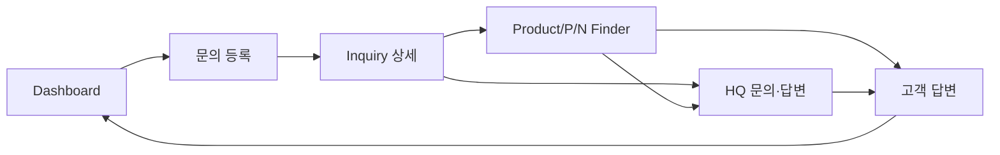
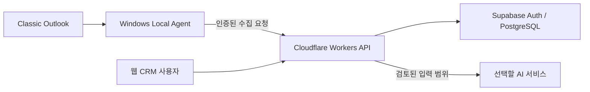

# Source Photonics sales CRM — 개발계획서

- 작성일: 2026-10-06
- 버전: 0.2 / 순차 진행 및 실자료 검증 반영
- 목적: 개인 Sales CRM의 MVP 범위와 검수 기준을 정하고, 실제 사용 후 확장할 개발 순서를 제시한다.
- 근거: 사용자가 제공한 AI 작업 팩과 ‘MVP by 여행가J’ 대화의 확인 가능한 후반부.
- 상태: 사용자가 본 계획의 순차 진행을 요청했고, 선택이 필요하지 않은 하위 작업은 계속 진행하도록 지시했다. 2026-10-06 실제 업무 자료의 Supabase 저장과 선택한 문의의 AI 전송을 허용했다. 계정·프로젝트·AI 서비스/비용을 확정한 뒤 연결하며, 배포·전체 사서함 AI 전송·이메일 자동 발송 허가로 확대하지 않는다.

## 1. 목표와 사용 범위

Source Photonics Korea Sales 담당자 본인 1인이 사용하는 웹 CRM을 만든다. 고객 문의 원문, 제품 요구사양, Product/P/N 후보, HQ 질문·답변, 고객 회신, Action Item과 Follow-up을 하나의 Inquiry에서 관리한다.

가장 먼저 얻어야 할 결과는 ‘오늘 고객에게 답할 것, HQ에 물을 것, 답변을 기다리는 것, 기한이 지난 것’을 Dashboard에서 구분하는 것이다. 고객이 정확한 P/N을 모르더라도 등록된 제품 자료에서 사양에 맞는 후보를 찾고 근거를 확인할 수 있어야 한다.

MVP는 실제 업무 흐름을 끝까지 처리하는 데 집중한다. 가격·납기·샘플·Forecast는 필요한 수동 기록을 허용하되 별도 영업 예측·견적·샘플 관리 모듈은 만들지 않는다. 사용자 추가를 고려해 데이터 소유자를 구분하지만 협업 UI와 세부 역할 권한은 확장 범위로 둔다.

### 성공 기준

1. 실제 고객 문의를 등록하고 고객·프로젝트에 연결한다.
2. 실제 제품 자료에서 사양으로 P/N 후보를 검색한다.
3. HQ 확인 또는 직접 고객 답변 경로를 선택한다.
4. 원문을 보존하면서 영문 HQ 문의와 한국어 고객 답변을 준비한다.
5. 회신·대기·Action·기한을 기록하고 Dashboard에서 다시 찾는다.
6. 1주 이상 실사용하며 주요 문의와 Follow-up을 누락 없이 추적한다. Excel·메모 의존 감소는 사용자 평가로 확인하며, 측정하지 않은 개선율을 만들어내지 않는다.

## 2. 확정 방향과 설계 제안

| 구분 | 내용 |
|---|---|
| 사용자 확정 | 프로젝트 이름, 1인 MVP 후 확장, 개발계획서 우선 작성 |
| 기존 기획 방향 | 웹 CRM, Cloudflare Workers, Supabase PostgreSQL, Classic Outlook + Windows Local Agent |
| 기존 기획 방향 | 6개 업무 화면, AI 초안·번역·요약, 사용자 최종 제품 선택·외부 발송 |
| 이번 설계 제안 | 문의·메시지·Action을 별도 데이터로 관리, 수집 메일 검토 후 Inquiry 연결, 구조화된 사양 필터 우선 |
| 사용자 확정(2026-10-06) | 받은 편지함·보낸 편지함의 최근 1개월 메일 수집, 이후 기간 확대 가능. 별도 Outlook 보관 폴더 없음 |
| 사용자 확정(2026-10-06) | 실제 업무 자료의 Supabase 저장 및 선택한 문의에 필요한 내용의 AI 전송 허용. 사용자 선택이 필요하지 않은 하위 작업은 연속 진행 |
| 사용자 확정(2026-10-06) | 기존 PC CRM 및 Supabase sp-crm은 Notion 강의로 만든 별도 작업. 이번 CRM은 별도 프로젝트로 개발하고 통합 여부는 추후 검토 |
| 사용자 확정(2026-10-06) | Source Photonics 조직에 별도 sp-sales-crm 생성. 서울 리전 우선, 유료 전환·기존 프로젝트 중단 없이 무료 생성 조건 확인 |
| 실제 확인(2026-10-06) | 새 sp-sales-crm 생성·서울 리전·DB 읽기 성공. 초기 업무 테이블 6개와 RLS 구조 및 가상 데이터 접근 격리 검증 통과. 지정 계정의 조회 권한 적용, 실제 사용자 로그인·Dashboard 재조회·로그아웃 확인. 등록·수정 및 전체 업무 E2E는 미완료 |
| 기본 업무 구현(2026-10-06) | 고객/담당자/프로젝트의 문의 내 생성·이름/메모 수정, 수동 Inquiry 등록·상세·종료 이력, Action 관리·Closed UI/API/DB 규칙 구현. 새 DB의 합성 데이터 ROLLBACK 검증과 가상 브라우저 흐름 통과. 사용자 ‘적용해’ 확인 후 실제 DB 규칙·쓰기 권한 적용 및 사후 검사 통과. 관리용 RLS 이벤트 함수의 클라이언트 실행 권한 제한과 자동 RLS 검증 완료. Security Advisor 오류 0건, 무료 플랜에서 유출 비밀번호 보호 경고 1건 보류. 지정 계정의 검증용 실제 쓰기 E2E와 두 DB 세션의 Action/종료 상호 잠금 대기를 확인했다. 경합의 커밋 순서별 결과는 미검증. 상세 기록은 docs/operations/2026-10-06-basic-work-write.md |
| 확인 필요 | Outlook 수집 기술 검증, 제품 원본의 검증·선정, AI 서비스·비용·데이터 전송 범위, 백업 방식, 배포 계정 |

기술 스택은 기존 기획을 유지한다. 지원 API, 실행 제약, 요금과 계정 조건은 구현 전 공식 문서 및 실제 환경으로 검증한다. 프런트엔드 프레임워크와 로컬 Agent 언어는 아직 확정하지 않는다.

## 3. MVP와 확장 범위

| 기능 | MVP에 포함 | 확장 시 검토 |
|---|---|---|
| 문의 등록 | Outlook 수집 메일 검토, 다른 채널 수동 입력, 고객·담당자·프로젝트 연결 | 자동 연결 정확도 개선, 일괄 분류 |
| 요구사양 | AI 추출 제안, 원문 비교, 사용자 수정·확인 | 분야별 추출 개선 |
| 제품 검색 | 승인된 제품 자료 가져오기, 사양 필터, 후보 비교·출처·확인일, 후보 연결 | 의미 검색, 자료 변경 추적, 검색 품질 개선 |
| HQ 문의 | 담당자·질문 선택, 영문 초안, 복사, 실제 발송 기록, 대기·Follow-up | 담당자 추천, 반복 문의 템플릿 |
| HQ 답변 | 원문 연결·붙여넣기, 한국어 번역·요약, 질문별 답변 여부 검토 | 다회차 답변 비교·분석 |
| 고객 답변 | 확인된 정보로 초안, 사용자 수정, 실제 회신일·최종 내용 기록 | 회신 템플릿 개선 |
| Dashboard | 고객 답변·HQ 문의·Follow-up·대기·Overdue, Next Action | 사용자별 보기·분석 |
| 기본 이력·종료 | 저장된 메시지·초안·최종 답변 조회, 고객·프로젝트 필터, Closed 처리 | 통합 상세 타임라인, 상태 변경 이력 UI, 고급 검색·재오픈 흐름 |
| 기반 운영 | 로그인, 소유자별 데이터 접근통제, 백업·복원 검증 | 다중 사용자 역할·권한 |

‘이력 조회와 종료’를 통째로 다음 버전으로 미루지 않는다. MVP 업무에 필요한 기록 보존·조회와 Closed는 포함하고 고급 이력 기능을 미룬다. ‘HQ 답변 정리’는 기존 기획의 필수 여부 표시와 관계없이, HQ 경로를 끝까지 처리하는 MVP 필수 기능으로 정리한다.

### MVP 제외

ERP/본사 CRM 직접 연동, Microsoft Graph API 직접 연동, 카카오톡·WeChat 자동 API 연동, 이메일 자동 발송, AI의 자동 제품 확정, 가격·Lead Time 자동 결정, 모든 첨부파일 자동 분석, 복잡한 다중 사용자 권한, 모바일 Native App, 회계·재고 기능.

제외 항목은 확장 단계에서도 자동으로 승인되지 않는다. 필요성과 보안·비용·연동 조건을 별도로 검토한다.

## 4. 사용자 흐름과 화면

기본 흐름은 Dashboard → 문의 등록 → Inquiry 상세 → Product/P/N Finder → HQ 문의·답변 → 고객 답변 → Dashboard이다. 제품을 직접 판단하면 Finder에서 고객 답변으로 이동하고, 제품검색이 필요 없으면 Inquiry 상세에서 바로 HQ 문의로 이동한다.

보드는 기존의 8개 핵심 연결을 유지한다. 실제 화면은 Dashboard 목록에서 기존 Inquiry 열기, Inquiry 상세에서 바로 고객 답변 준비, 고객 답변에서 Inquiry로 돌아가기를 지원한다. 각 이동은 같은 Inquiry를 유지하며, 페이지를 열었다는 이유로 상태를 변경하지 않는다.

| 화면 | 핵심 행동·정보 | 빈 상태 | 오류·예외 처리 |
|---|---|---|---|
| Dashboard | Action 분류, 대기 대상·Due Date·Next Action, 문의 열기 | 처리할 업무 없음과 새 문의 등록 표시 | 조회 실패를 0건으로 표시하지 않고 재조회 제공 |
| 문의 등록 | 메일 검토·신규/기존 연결, 수동 문의, 고객·프로젝트 저장 | 수집 메일 없음·수동 등록 안내 | 필수 항목 오류, 중복 경고, 저장 실패 시 입력 유지 |
| Inquiry 상세 | 원문·요구사양, 후보·답변, Action 편집, 상태·Closed | 아직 없는 사양·후속 업무를 구분 | AI 실패 시 수동 작성, 저장 충돌 시 재조회·내용 보존 |
| Product/P/N Finder | 속도·거리·온도·파장·Form Factor 등 필터, 후보·출처 비교 | DB 비어 있음과 조건에 맞는 후보 없음 구분 | 미확인 사양·충돌 자료 표시, HQ 확인 경로 제공 |
| HQ 문의·답변 | 질문·담당자·영문 초안, 발송 기록, 원문·번역·미답변 질문 | HQ 문의/답변 아직 없음 | 번역 실패 시 원문 유지, 답변 부족 시 추가 Action |
| 고객 답변 | 선택 P/N·확인 정보·한국어 초안, 복사·실제 회신 기록 | 답변 자료 부족 안내 | 미확인 가격·납기 표시, 초안 생성 실패 시 직접 입력 |

고객·담당자·프로젝트의 최소 생성·수정은 문의 등록과 상세 화면 안에서 지원한다. 로그인과 운영 설정은 6개 업무 화면 외의 보조 화면이다. 제품 가져오기는 초기에는 검증 가능한 관리 절차로 제공하며 별도 고급 관리 화면은 필수가 아니다.

## 5. 문의·Action 상태 규칙

설계 제안: 문의의 대표 진행 상태와 여러 개의 후속 Action을 구분한다. 한 문의에 고객 확인과 HQ 확인이 동시에 필요할 수 있으므로 단일 상태만으로 모든 업무를 표현하지 않는다.

| Inquiry 상태 | 의미 |
|---|---|
| New | 등록 후 요구사항·다음 행동 검토 필요 |
| Product Search | 제품 후보 확인 중 |
| Need HQ Confirmation | HQ 질문 준비·실제 문의 필요 |
| Waiting for HQ | 실제 HQ 문의 후 답변 대기 |
| Customer Reply Needed | 고객 답변 준비·실제 회신 필요 |
| Waiting for Customer | 실제 고객 회신 후 추가 답변 대기 |
| Closed | 주요 질문이 해결되고 남은 필수 업무가 없음 |

- Action에는 종류(Customer Reply / HQ Inquiry / HQ Follow-up / Customer Follow-up / Other), 완료 여부, 담당 HQ 연락처 또는 대기 대상, Due Date, Next Action을 저장한다.
- Waiting은 대기 대상과 시작일을 기록한다. Follow-up할 날짜는 별도 Action의 Due Date로 설정한다.
- Overdue는 독립 상태가 아니라 ‘미완료 Action의 Due Date가 현재 날짜보다 이전’인 표시다. 날짜 판단 기준은 Asia/Seoul이다. 오늘 기한은 Today로 표시하며 아직 Overdue가 아니다.
- 대시보드의 업무 분류는 겹칠 수 있다. 합계는 고유 Action 또는 고유 Inquiry 중 어떤 기준인지 화면에 표시해 중복 합산을 피한다.
- 초안 생성·복사는 발송 완료가 아니다. 사용자가 실제 발송일·회신일을 기록해야 대기 상태로 바뀐다.
- HQ 답변이 와도 모든 질문이 해결되었다고 자동 처리하지 않는다. 사용자가 답변 충분성을 검토한다.
- Closed 전 미완료 Action을 보여준다. 필수 Action을 완료하거나 불필요 사유를 남겨 취소한 후 종료한다. 미답변 상태를 자동으로 감추지 않는다.

## 6. 데이터 설계안

아래는 구현 전 확정할 논리 구조다. 모든 업무 데이터에는 식별자, owner_id, 생성·수정 시각을 두고 소유자 접근을 검사한다. 시각은 UTC 저장, 사용자 표시는 Asia/Seoul을 기본으로 한다.

| 데이터 | 핵심 항목·관계 |
|---|---|
| Customer / Contact | 고객사, 담당자, 업무 연락처; 담당자는 고객사와 연결 |
| Project | 고객사, 프로젝트명, 설명·진행 메모 |
| Inquiry | 제목, 접수 채널·시각, 고객·담당자·프로젝트, 대표 상태, 요구사양, Next Action |
| Message | Inquiry 연결, 방향·채널, 발신/수신자, 원문, 제목, 실제 발송/수신 시각, 수집 식별자 |
| Requirement | 사양명·값·단위, 원문 근거, AI 제안/사용자 확인 여부, 미확인 내용 |
| Product / Source | P/N, 제품명, 주요 사양, Active/EOL/Development 또는 Unknown, PLM Owner, 출처·자료일·Last Confirmed |
| Inquiry Product | 문의와 후보 연결, 선택/확인 필요, 선택 근거·확인일 |
| HQ Question / Response | 질문과 관련 답변 메시지 연결, 답변됨/부분 답변/미답변, 사용자 검토 |
| Draft | HQ/고객 초안·번역·요약, 근거 메시지, 사용자 수정본, 생성 시각·모델 정보 |
| Action | Inquiry, 종류, 내용, 기한, 완료/취소, 대기 대상·시작일 |
| Sync Receipt | Agent·메일 식별자, 수집/반영 결과, 오류·마지막 성공 시각 |

하나의 Inquiry에 여러 메시지·후보·HQ 질문·Action을 연결한다. 원문을 번역·요약으로 덮어쓰지 않는다. 고객·프로젝트 변경으로 기존 문의를 삭제하지 않는다. 가격·납기는 후보 제품의 일반 확정값으로 저장하지 않고 해당 문의에서 확인 출처·확인일과 함께 기록한다.

원문·최종 답변·발송 기록은 MVP부터 보존한다. 상세 변경 이력 UI가 다음 버전이라는 이유로 원천 데이터를 버리지 않는다. 초안 전체 버전 관리의 범위는 구현 시 저장량과 사용성을 고려해 확정한다.

## 7. 시스템 구조와 연동

웹 CRM은 문의·제품 검색·Action·초안 기능을 제공한다. Workers API는 접근통제와 업무 규칙, AI 호출, 수집 요청을 처리한다. Supabase는 로그인과 업무 데이터를 관리한다. 로컬 Agent는 지정 Outlook 범위에서 읽은 메일을 전송한다. 서비스 권한 키와 AI 키는 브라우저에 제공하지 않는다.

### Outlook 수집 제안

1차 검증 결과: 실행 중인 Classic Outlook COM으로 최근 1개월 받은 메일 293건·보낸 메일 48건을 조회했다. 폴더별 표본 ID 재조회 성공. 가상 SQLite 실험의 중복·재개·영수증 보존 및 조회 기간 경계 테스트 9건 통과. 이는 서버 전송·실제 메일 중단 복구·운영 Agent 검수 통과가 아니다. 수집 실험 코드와 증거는 별도 기록을 따른다.

1. 실제 PC의 Classic Outlook·프로필·폴더 접근을 소량 메일로 확인한다. 구현 인터페이스는 실환경 검증 후 선택한다.
2. 초기 수집 대상은 받은 편지함과 보낸 편지함이며 별도 보관 폴더는 없다. 초기 수집 기간은 최근 1개월로 시작하며 사용자 요청에 따라 확대할 수 있도록 한다. 최초 실행 시 정확한 시작·종료 시각을 표시하고 기록한다. 수신 메일은 수신 시각, 발송 메일은 발송 시각으로 기간을 판단한다. 전체 사서함을 기본 수집하지 않는다. 기간 확대 후에도 기존 메일은 중복 반영하지 않는다.
3. 메일은 CRM의 수집 대기 목록에 넣고 사용자가 신규 Inquiry 또는 기존 Inquiry 연결을 확인한다. 새 메일마다 Inquiry를 무조건 만들지 않는다.
4. 메일 고유 식별자와 사서함 범위를 바탕으로 같은 메일 재전송을 중복 반영하지 않는다. 폴더 이동·답장·전달 사례로 검증한다.
5. 제목만으로 자동 병합하지 않는다. 대화 식별자 등은 연결 후보를 제시하는 근거로 쓰고 사용자가 수정할 수 있게 한다.
6. 보낸 편지함도 수집한다. 고객 중간·최종 회신과 HQ 문의의 실제 발송 기록에 활용하되 자동 연결 오류를 검토할 수 있어야 한다.
7. PC 종료·네트워크 중단 후 마지막 성공 지점부터 재수집한다. Agent에 미전송 목록과 성공 응답을 관리한다.
8. 오류 원인을 구분하고 일시 오류만 제한적으로 재시도한다. 인증·설정 오류는 같은 조건으로 반복하지 않는다.
9. CRM에서 마지막 동기화 시각과 오류를 확인한다. 첨부파일은 기본 메타데이터만 고려하며 자동 내용 분석은 제외한다.

자동수집이 막히면 수동 등록으로 CRM 핵심 기능을 계속 검증하되, 이를 Outlook 자동수집 완료로 보고하지 않는다. 사용자 동의 없이 해당 완료 기준을 낮추지 않는다.

### Product Database 준비

- 사용자가 지정한 Excel·제품 리스트·Datasheet·견적에서 초기 제품군을 선정한다. Google Drive 자동 연동은 MVP 필수로 두지 않는다.
- P/N, 제품명, 데이터 속도, Form Factor, Reach·단위, 파장, 온도 범위, 관련 규격, 제품 상태, 출처를 정의한다. 제품군별 추가 사양은 실제 자료에 맞춘다.
- 원본 값을 유지하고 검색용 표준값을 따로 관리한다. 없는 값은 Unknown이며 추정으로 채우지 않는다.
- 자료가 모순되면 확인 필요로 표시한다. 자료일과 실제 확인일을 구분하며, 오래된 견적만으로 현재 판매 가능 여부를 확정하지 않는다.
- 처음에는 구조화된 필터 검색으로 시작한다. AI가 등록되지 않은 P/N을 만들어 검색 결과로 제시하지 않도록 한다.
- 가져오기 전 미리보기, 중복·단위 검증, 적용 건수 확인, 잘못된 배치 복구 절차를 둔다.

## 8. AI 사용 규칙

AI 적용 범위는 요구사양 추출, HQ 영문 초안, HQ 답변 한국어 번역·요약, 질문별 답변 여부 제안, 고객 한국어 초안, Action 제안이다.

- 고객/HQ 원문과 사용자 확인 데이터를 근거로 사용한다. 숫자·단위·P/N·부정 표현·조건을 보존한다.
- 원문에 없는 사양, 가격, 납기, 제품 상태를 확정하지 않는다. 누락된 것은 추가 확인 항목으로 표시한다.
- AI 결과와 사용자 확정값을 구분한다. 제품 선택·답변 충분성·실제 발송은 사용자가 확인한다.
- 실패 시 원문·입력을 유지하고 수동 편집할 수 있게 한다. 실패·시간 초과를 빈 결과나 정상 완료로 처리하지 않는다.
- 생성 시 필요한 문의·질문·선택 자료만 전송한다. 전체 사서함·모든 가격자료를 기본으로 보내지 않는다.
- 2026-10-06 사용자는 실제 업무 자료의 Supabase 저장 및 선택한 문의의 AI 전송을 허용했다. AI 서비스·모델·비용 상한은 아직 미결정이며, 해당 결정과 인증 전 실제 AI 호출은 하지 않는다.
- AI 서비스, 모델, 처리 지역·보존 조건, 비용 상한과 사용량 확인 방법은 도입 전에 결정한다.
- 실제 평가 사례를 선정해 기술 용어·수치 보존, 없는 사실 생성 여부, 누락 질문 탐지, 초안 사용성을 확인한다. 테스트 건수·합격 기준은 실제 자료 검토 후 확정한다.

## 9. 로그인·접근통제·백업

공개 회원가입은 기본 비활성으로 제안한다. 1인 계정의 데이터만 읽고 수정할 수 있도록 API와 DB 접근 규칙을 검증한다. 향후 사용자 추가에 대비하되 현재 팀 협업 기능을 구현하지 않는다.

기존 Supabase sp-crm의 테이블·데이터·연결 PC CRM은 보존한다. 이번 CRM은 별도 Supabase 프로젝트를 사용하며, 기존 테이블이나 허용 계정을 가져오거나 변경하지 않는다. 두 시스템 통합은 향후 사용자 요청 시 데이터 구조·소유자·중복·접근통제·복원 방법을 비교한 후 검토한다. 현재 MVP에 통합 작업을 추가하지 않는다.

Agent에는 수집에 필요한 최소 권한만 부여한다. Agent 인증정보를 제품 DB·문서·로그에 기록하지 않는다. 로그는 오류 유형·식별자·건수 중심으로 남기며 메일 본문과 가격·연락처를 기본 출력하지 않는다.

백업 주기와 위치는 실제 서비스 플랜 및 회사 정책을 확인해 정한다. 제안은 정기 백업과 데이터 가져오기·스키마 변경 전 백업이다. DB 외 제품 원본·첨부파일·Agent 미전송 데이터의 복구 범위도 명시한다. 별도 테스트 환경에서 복원하고 문의·메시지·후속 업무 건수와 연결을 확인해야 백업 검증 완료로 인정한다.

## 10. 개발 순서와 산출물

각 단계는 앞 단계의 검증 결과를 반영한다. 구현 전 세부 기술·작업 단위·의존성을 확정한다.

| 단계 | 작업 | 산출물·통과 조건 |
|---|---|---|
| 0. 계획 확정 | MVP 범위, 미결정 항목, 실제 검수 자료 선정 | 승인된 계획서와 검수 사례 목록 |
| 1. 위험 요소 확인 | Outlook 소량 수집, 제품 원본 샘플 정리, 계정·AI 처리 조건 확인 | 가능/제약/대안 기록; 일정 재산정 |
| 2. 기본 업무 | 로그인·접근통제, 고객/프로젝트, 수동 Inquiry, Action·Dashboard·Closed | AI 없이 수동 문의를 끝까지 처리 |
| 3. 제품 검색 | 검증된 원본 가져오기, 사양 필터·후보 비교·문의 연결 | 실제 제품 조건과 일치하는 검색 결과·근거 확인 |
| 4. 커뮤니케이션 | HQ 질문/답변, 초안·번역, 고객 답변, 실제 발송 기록 | 직접 답변·HQ 확인·추가 문의 경로 검수 |
| 5. 수집 연결 | Agent 인증, 메일 대기·연결·중복 방지·중단 후 복구 | 실제 Outlook 메일 반영·재수집 검수 |
| 6. 운영 검수 | 전체 흐름, 오류·빈 상태, 소유자 접근, 백업·복원 | MVP 사용 시작 체크리스트 통과 |
| 7. 실사용 | 1주 이상 실제 문의 처리, 누락·불편 기록 | 실사용 보고와 확장 우선순위 |

Outlook 가능성 확인은 초기에 하되 전체 수집 구현이 수동 업무·제품검색 개발을 막지 않도록 분리한다.

### 목표 일정

- 2026-10-06~10-09: 계획 확정, 실데이터 선정, Outlook·제품 자료·운영 조건 확인 목표.
- 2026-10-10: 중간 검토. 수동 Inquiry→Action→Dashboard와 제품검색의 진행 결과, Outlook 검증 결과를 보고 일정·범위를 판단.
- 2026-10-11~10-17: 핵심 기능 연결과 운영 검수 목표.
- 2026-10-18: MVP 사용 시작 목표. 검수 미통과 항목은 명시하며 일정만 맞추기 위해 완료 처리하지 않음.
- 2026-10-18~10-24: 최소 1주 실사용 목표.
- 2026-10-25 이후: 실사용 검토 결과에 따른 MVP 완료 판단 및 확장 계획 확정.

위 날짜는 기존 목표에 맞춘 제안이며 소요기간을 검증한 확정 일정이 아니다. 개발 인력·원본 자료·접근 조건과 1단계 결과에 따라 조정한다.

## 11. MVP 검수 체크리스트

| ID | 검수 상황 | 합격 기준 |
|---|---|---|
| A01 | 로그인하지 않은 접근·다른 소유자 데이터 요청 | 비공개 업무 데이터 조회·수정 차단 |
| A02 | 수동 문의 등록·수정·다시 열기 | 원문·채널·고객·프로젝트·입력값 보존 |
| A03 | 같은 메일 반복 전송, 고객의 후속 답장 | 메일 중복 없음; 신규/기존 Inquiry 연결 검토 가능 |
| A04 | Agent/네트워크 중단 후 재시작 | 미전송 메일 누락·중복 없이 복구; 마지막 성공 시각 확인 |
| A05 | 원문에 없는 제품 조건 | AI 제안이 확정 조건으로 저장되지 않음; 사용자 수정 가능 |
| A06 | 실제 사양 필터·P/N 검색 | 등록 자료에 근거한 후보·사양·출처 표시; 결과 없음 구분 |
| A07 | 후보 확정 및 HQ 확인 필요 | 선택 근거 보존; 각각 고객 답변/HQ 경로 진행 |
| A08 | HQ 초안 복사와 실제 발송 기록 | 복사만으로 Waiting 전환 안 됨; 실제 발송 후 기록 |
| A09 | HQ 부분 답변·추가 질문 | 원문·번역 보존; 미답변 질문과 추가 Action 등록 |
| A10 | 미확인 가격·납기의 고객 초안 | 확정 표현 생성 방지; 사용자 확인 정보로 회신 기록 |
| A11 | 오늘/지난 기한·완료/취소 Action | Today·Overdue 구분; 완료·취소는 미완료 목록에서 제외 |
| A12 | 고객·프로젝트 조회·Closed 문의 | 저장된 문의·메시지·최종 답변 조회 가능 |
| A13 | 검색·저장·AI 호출 실패 | 실패 안내, 원문·입력 유지, 수동 진행 또는 재조회 가능 |
| A14 | 백업 복원 | 별도 환경에서 핵심 건수·관계·내용 확인 |
| A15 | 1주 실제 업무 | 주요 문의·후속 업무 누락 여부와 별도 메모 의존 평가 |

실제 메일·제품으로 기능/E2E를 검증하되 개발·테스트 과정의 데이터는 사용자가 지정한 범위만 사용한다. 시연 화면만으로 검수 완료를 판정하지 않는다.

## 12. 확장 로드맵

1. **업무 안정화:** 수집·문의 연결 오류 개선, 제품 DB 품질 보완, 반복 작업 템플릿. 실사용에서 확인된 결함을 먼저 해결한다.
2. **이력·검색 강화:** 통합 상세 타임라인, 상태 변경 이력, 고급 고객/프로젝트 검색, 재오픈, 질문·답변 비교.
3. **영업 정보 확장:** 필요가 확인되면 가격/견적·샘플·Forecast의 별도 구조와 화면을 설계한다. 단순 기록을 자동 의사결정으로 확대하지 않는다.
4. **협업·분석:** 실제 사용자 추가 요청 시 역할 권한·공유 범위·업무 배정·분석을 설계한다.

확장 착수 조건은 MVP 실사용 결과, 구체적인 해결 문제, 필요한 데이터, 비용·운영 조건, 검수 기준이 정리되어 있는 것이다.

## 13. 구현 전에 확인할 항목

| 항목 | 필요한 결정 | 계획상 제안 |
|---|---|---|
| Outlook | 버전·프로필 및 수집 기술 검증 | 받은·보낸 편지함 최근 1개월 확정, 별도 보관 폴더 없음; 소량 검증 후 적용 |
| 제품 자료 | 지정 자료 폴더의 초기 제품군·원본 검증·확인 담당 기준 | 고객별 폴더와 Datasheet 폴더 접근 확인; 상세 로컬 경로는 notes에 기록 |
| AI | 서비스·모델·비용·회사 자료 외부 처리 범위 | 필요한 입력만 사용자 실행 시 처리 |
| 운영 계정 | Cloudflare/Supabase 계정·프로젝트·로그인 계정 | 비공개 1인 접근, 공개 가입 제한 |
| 백업 | 주기·보관 위치·기간·복구 목표 | 정기 및 중요 변경 전 백업, 복원 검수 |
| 기술 세부 | 프런트엔드·Agent 언어·호스팅 방식 | 실환경 결과와 유지보수성을 보고 선택 |
| 일정 | 중간 검토에서 보여줄 범위와 사용 시작 조건 | 기술 검증 후 목표 일정 재확인 |

미결정 항목을 구현 완료로 가정하지 않는다. 원본 AI 작업 팩과 기존 배치 보드는 보존하고, 본 문서의 수정 이력으로 후속 결정을 관리한다.

## 14. 변경 이력

| 날짜 | 버전 | 내용 |
|---|---|---|
| 2026-10-06 | 0.1 | 프로젝트 이름 반영, 기존 6개 화면·8개 연결 유지, MVP/확장·상태·데이터·수집·AI·검수 계획 정리 |
| 2026-10-06 | 0.1 보완 | 초기 메일 최근 1개월·기간 확대 가능 반영, 제품·고객 원본 폴더 접근 확인 |
| 2026-10-06 | 0.2 | 실제 사례 3건, Outlook 읽기 검증·가상 수집 실험 반영; 연속 진행 및 Supabase 저장/선택 문의 AI 전송 허용 기록 |
| 2026-10-06 | 0.2 보완 | 기존 Notion 기반 sp-crm 및 PC CRM 보존, 새 프로젝트 분리 확정. 향후 통합 검토는 유보 |
| 2026-10-06 | 0.2 보완 | 기본 업무 등록·Action·Closed 구현과 격리 검증 결과, 실제 쓰기 적용/검증의 미완료 경계 반영 |
| 2026-10-06 | 0.2 보완 | 사용자 실행 시점 승인 후 새 DB 규칙·쓰기 권한 실제 적용, 사후 검사 및 보안 Advisor 점검. RLS 자동 활성화 유지·클라이언트 실행 권한 제한. 실제 계정 쓰기 E2E는 로그인 대기 |

## 2026-10-06 추가 진행 기록

- 사용자 직접 로그인 후 고객·담당자·프로젝트 각 1개, 검증용 문의 2개를 실제 등록·수정·연결했다. Action 완료·사유 있는 취소·선택 업무 보존, 필수 미완료/해결 확인 없는 종료 차단, 종료 후 Dashboard 제외와 이력 재조회 확인. 실제 고객 업무 검수와 구분한다.
- 고객명 저장 직후 상세 표시와 저장 완료 안내를 보완하고 격리 화면에서 확인했다. Node 32/32 및 운영 빌드 통과.
- 사용자 선택 확정: 초기 제품 검색은 정리된 100G LR4 SPQ-CE-4LQ-CB, SR4 SPQ-CE-4SQ-CA 두 제품으로 먼저 검증한다. 판매 상태·최신본 여부·가격·납기는 미확인으로 유지한다.
